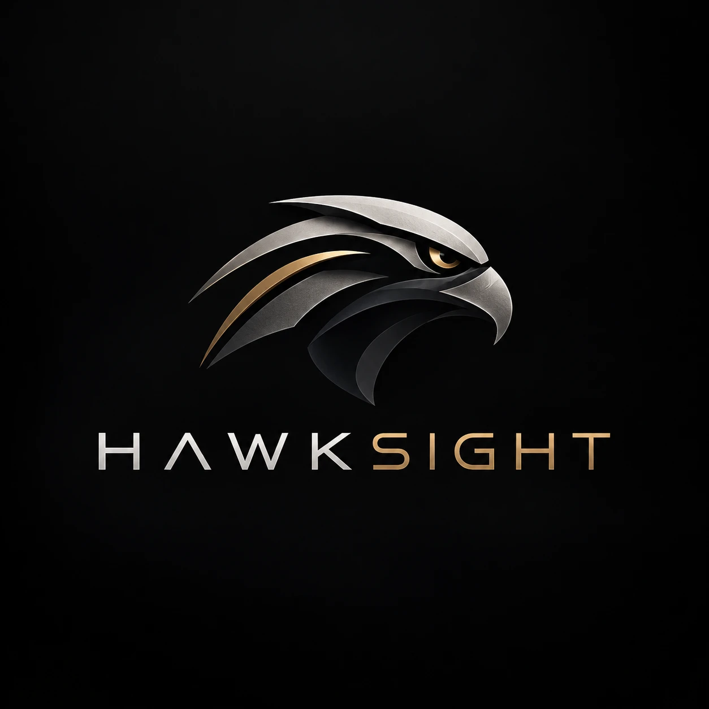

# HawkSight brand

## Idea

HawkSight sees clearly and acts precisely. The identity is light and exact: white and mist surfaces, graphite type, and one warm accent that stands for the hawk's eye.

## Mark

The HawkSight hawk: a faceted silver hawk's head with a gold sweep along the nape and a gold eye, paired with the HAWKSIGHT logotype ("HAWK" in silver, "SIGHT" in gold). The master artwork is `docs/brand/hawksight-logo-master.png` (silver and gold on graphite).

| Asset | File (`assets/brand/`) | Use |
|---|---|---|
| App tile | `hawksight-tile.png` | Default at small sizes on light surfaces: sidebar, site header, footer, report cover |
| Mark, reversed | `hawksight-mark-reversed.png` | Original colours, for graphite surfaces (sign-in panel, social image) |
| Mark, light | `hawksight-mark.png` | Graphite-ink version for large or watermark use on light surfaces (landing hero) |
| Logotype | `hawksight-wordmark.png` | Graphite and deep gold, for light surfaces |
| Logotype, reversed | `hawksight-wordmark-reversed.png` | Silver and gold, for graphite surfaces |
| Favicons | `favicon-32.png`, `apple-touch-icon.png`, `/favicon.svg` | Browser tab and home-screen icon |
| Social image | `og-image.png` | Link previews (1200 x 630) |

Rules:

- On light surfaces at small sizes, always use the tile. The silver artwork loses contrast on white without it.
- Large, faint versions of the mark may be used as a background motif (about 7% opacity on light, 20% on graphite).
- Do not recolour the hawk, stretch it, add effects, or place it on busy imagery.

Source: `js/core/util.js` (`LOGO`, `LOGO_LIGHT`, `wordmark()`).

## Wordmark

The HAWKSIGHT logotype image, with "by HiQurate Ops" or the area name beneath in JetBrains Mono, uppercase, letter-spaced. In running text the product name is written "HawkSight".

## Colour

| Name | Hex | Use |
|---|---|---|
| White | #FFFFFF | Main surfaces |
| Mist | #F6F7F9 | Page background and alternating sections |
| Graphite | #0B0E13 | Primary text, primary buttons, the hawk |
| Hawk-eye amber | #F5A524 | The accent: small highlights, focus, active navigation; matches the gold in the logo |
| Amber deep | #D9890B | Accent on light surfaces (bars, rules) |
| Amber ink | #7A4D00 | Accent text on light surfaces (meets contrast) |
| Slate | #5D6572 | Secondary text |

Use amber sparingly: one accent element per view is usually enough. Severity colours (red, orange, yellow, blue) are reserved for findings and must not be used decoratively.

## Type

- Inter for all text. Large headings use weight 700 and tight tracking (-0.04em).
- JetBrains Mono for small technical labels: section numbers, kickers, metadata.

## Voice

Plain, precise, calm. No exclamation marks, no emoji, no hype. Say what the product does and what it does not claim.
